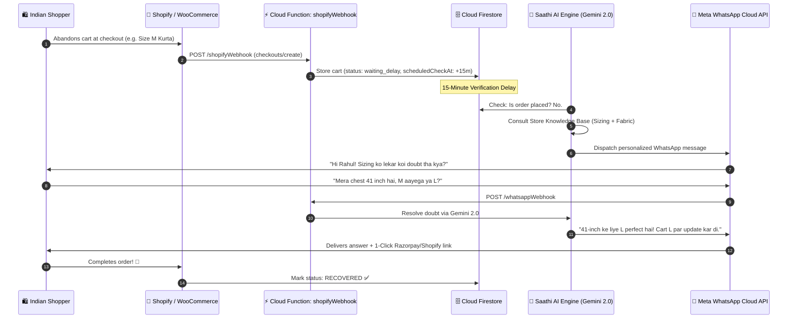

# Saathi by Kahol Labs (साथी) — Admin & Cart Recovery Engine

<p align="center">
  <a href="https://kahollabs-saathi.web.app">
    
  </a>
</p>

> **Aapke Online Business ka AI Sales Partner**  
> Autonomous WhatsApp Sales Recovery Engine & Merchant Admin for Shopify & WooCommerce Brands.

[](https://kahollabs-saathi.web.app)
[](https://kahol-labs-website.web.app)
[](https://firebase.google.com/)
[](https://nodejs.org/)
[](https://deepmind.google/technologies/gemini/)
[](https://developers.facebook.com/docs/whatsapp/cloud-api)

---

## 🌟 Brand Vision & Objective

Jab ek Indian shopper cart me item chhod kar jaata hai, toh 90% cases me discount ki kami nahi hoti—balki **doubts** hote hain:
* *"Bhaiya mera chest 41 inch hai, M aayega ya L tight hoga?"*
* *"Pure cotton hai kya? Wash karne ke baad shrink toh nahi hoga?"*
* *"Bangalore me delivery kab tak milegi? COD available hai?"*

Shopify ka native WhatsApp automation sirf ek **one-way robotic template** bhejta hai. Jab customer reply karta hai, toh woh ek unstaffed inbox me dump ho jata hai.

**Saathi by Kahol Labs** store owner ke paas ek **24/7 Digital Sales Closer** ki tarah khada rehta hai:
1. Abandoned checkouts ko **real-time capture** karta hai.
2. 15-minute wait karta hai taaki customer naturally order complete kar sake.
3. Agar order nahi hua, toh store ke sizing chart aur fabric rules ke hisab se ek **warm, personalized WhatsApp message** bhejta hai.
4. Customer ke sizing aur fabric doubts ko **5 second me solve** karke order close karta hai.

---

## 🔗 Live Experience & Links

* 🚀 **Live Merchant & Super Admin Dashboard:** [https://kahollabs-saathi.web.app](https://kahollabs-saathi.web.app)
* ⚡ **Live Shopify Webhook:** `https://shopifywebhook-wb5fbwbodq-el.a.run.app?storeId=neer`
* 📱 **Live WhatsApp Webhook:** `https://whatsappwebhook-wb5fbwbodq-el.a.run.app`
* 🏢 **Crafted by:** [Kahol Labs](https://kahol-labs-website.web.app) — Independent Software Development & AI Studio
* 🤖 **AI Capabilities:** [Explore Kahol Labs Applied AI Solutions](https://kahol-labs-website.web.app/ai)

---

## 🏗️ Architecture & Data Flow



---

## 🗄️ Firestore Database Collections

* `stores/{storeId}`: Store metadata, WhatsApp sender credentials, sizing charts, fabric rules, return policy, and brand tone.
* `abandoned_checkouts/{checkoutId}`: Inbound carts with customer name, phone, item details, price, status (`waiting_delay`, `outreach_sent`, `chatting`, `recovered`), and recovery timestamps.
* `conversations/{conversationId}`: WhatsApp conversation history, message timestamps, active state, and human takeover flags.

---

## 🚀 Quick Start & Development

### 1. Prerequisites
* Node.js >= 22.0.0
* Firebase CLI (`npm install -g firebase-tools`)

### 2. Install & Test
```bash
# Run unit and end-to-end integration tests
npm test
```

### 3. Deploy to Firebase (asia-south1)
```bash
firebase deploy --only functions,firestore,hosting --project kahollabs-saathi
```

---

## 🔐 Environment & Secret Configuration
The following keys are managed securely via Firebase Secret Manager:
* `SHOPIFY_WEBHOOK_SECRET`: HMAC verification key for Shopify checkouts.
* `META_WHATSAPP_TOKEN`: System user access token for WhatsApp Cloud API.
* `META_PHONE_NUMBER_ID`: WhatsApp Business Account phone number ID.
* `META_VERIFY_TOKEN`: Webhook challenge token for Meta Webhook setup.
* `GEMINI_API_KEY`: Google Gemini 2.0 Flash API key.

---

## 📜 Studio Attribution & Contact

* **Studio:** [Kahol Labs](https://kahol-labs-website.web.app)
* **Founder:** Abhinadan Kahol
* **Email:** [kahollabs@gmail.com](mailto:kahollabs@gmail.com)
* **WhatsApp:** [+91 70189 18026](https://wa.me/917018918026)
* **Location:** Himachal Pradesh & Punjab, India

---

## 📄 License & Ownership
Copyright © 2026 **Kahol Labs** (`https://kahollabs.com`). All Rights Reserved.
Founded by **Abhinadan Kahol**.
